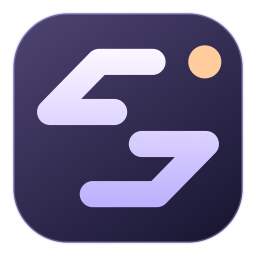
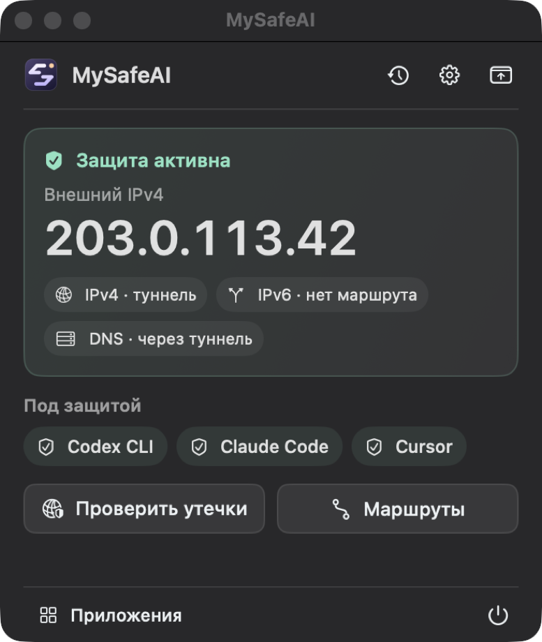
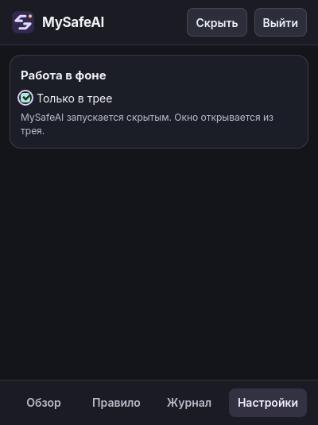

  

<h1 align="center">MySafeAI</h1>

  <strong>VPN kill switch для Codex, Claude Code, Cursor и других приложений</strong> 
  Локальная проверка внешнего IP через VPN и при прямом подключении. Пауза приложений до подтверждения адреса.

  
  
  

  
  

  <a href="#скачать">Скачать</a> ·
  <a href="#как-работает-защита">Возможности</a> ·
  <a href="#интерфейс">Интерфейс</a> ·
  <a href="docs/guide.md">Руководство</a> ·
  <a href="#поддержать-проект">Поддержать</a>

## Скачать

| Система | Apple Silicon / ARM64 | Intel / AMD x64 |
| --- | --- | --- |
| **macOS 14+** | [ZIP](https://github.com/in-devp/MySafeAI/releases/latest/download/MySafeAI-macOS-arm64.zip) | [ZIP](https://github.com/in-devp/MySafeAI/releases/latest/download/MySafeAI-macOS-x64.zip) |
| **Windows 10+** | [ZIP](https://github.com/in-devp/MySafeAI/releases/latest/download/MySafeAI-Windows-arm64.zip) | [ZIP](https://github.com/in-devp/MySafeAI/releases/latest/download/MySafeAI-Windows-x64.zip) |
| **Ubuntu 26.04** | [DEB](https://github.com/in-devp/MySafeAI/releases/latest/download/MySafeAI-Linux-arm64.deb) · [TAR.GZ](https://github.com/in-devp/MySafeAI/releases/latest/download/MySafeAI-Linux-arm64.tar.gz) | [DEB](https://github.com/in-devp/MySafeAI/releases/latest/download/MySafeAI-Linux-x64.deb) · [TAR.GZ](https://github.com/in-devp/MySafeAI/releases/latest/download/MySafeAI-Linux-x64.tar.gz) |
| **Arch Linux** | — | [PKG.TAR.ZST](https://github.com/in-devp/MySafeAI/releases/latest/download/MySafeAI-Arch-x64.pkg.tar.zst) |
| **FreeBSD 15.1** | — | [TAR.GZ](https://github.com/in-devp/MySafeAI/releases/latest/download/MySafeAI-FreeBSD-amd64.tar.gz) |

[Все релизы](https://github.com/in-devp/MySafeAI/releases) · [SHA-256](https://github.com/in-devp/MySafeAI/releases/latest/download/SHA256SUMS.txt)

<strong>Как установить</strong>

- **macOS** — распакуйте ZIP, перенесите `MySafeAI.app` в «Программы» и откройте оттуда. Сборка подписана ad-hoc, macOS может запросить подтверждение в «Конфиденциальность и безопасность».
- **Windows** — распакуйте ZIP и запустите `MySafeAI-Desktop.exe`. Приложению нужен Microsoft WebView2 Runtime.
- **Ubuntu** — установите DEB командой `sudo apt install ./MySafeAI-Linux-*.deb` и откройте приложение из меню.
- **Arch Linux** — установите пакет командой `sudo pacman -U ./MySafeAI-Arch-x64.pkg.tar.zst` и откройте приложение из меню.
- **FreeBSD** — установите зависимости командой `sudo pkg install gtk4 webkit2-gtk_60 glib-networking`, распакуйте архив и запустите `./mysafeai` в графическом сеансе.

## Интерфейс

<table>
  <tr>
    <th>macOS · обзор защиты</th>
    <th>Arch Linux · работа в фоне</th>
  </tr>
  <tr>
    <td valign="top"></td>
    <td valign="top"></td>
  </tr>
</table>

На скриншоте macOS использован демонстрационный IP.

## Как работает защита

- **Подтверждение IP.** Два независимых источника проверяют адрес через VPN, Wi-Fi или Ethernet. MySafeAI предлагает разрешить новый адрес и держит выбранные приложения и их дочерние процессы на паузе до подтверждения. Команда `mysafeai run -- codex` проверяет подключение перед запуском.
- **Управление защитой.** Защиту можно отключить до ручного включения или приостановить на 15 минут. MySafeAI остаётся открытым. Время окончания паузы сохраняется при перезапуске, а при возобновлении MySafeAI заново проверяет подключение.
- **Правила подключения.** Прямые IP разрешаются отдельно. Для каждого приложения можно выбрать автоматический режим, «Только VPN», проверку маршрута до сервиса или системный прокси с PAC. Правила поддерживают IP, подсети CIDR, страны и доверенные локальные сети.
- **Диагностика.** Проверка утечек сравнивает прямой и системный выход, проверяет IPv6 и маршруты DNS. События хранятся в локальном журнале.
- **Режим «Только в трее».** Окно можно скрыть, пока защита работает. На macOS значок в строке меню открывает компактную панель. На Linux и FreeBSD нужен системный трей с поддержкой StatusNotifierItem.

MySafeAI работает локально, без аккаунта. Сервисы проверки IP видят адрес своих запросов. Маршруты DNS проверяются локально, внешний тест через bash.ws включается отдельно. Процессная защита реагирует на изменения маршрута и результаты проверок. Сетевую блокировку пакетов при обрыве обеспечивает VPN-клиент с собственным kill switch.

[Настройка защиты, диагностика и сборка из исходников](docs/guide.md)

## Поддержать проект

MySafeAI бесплатный, исходный код открыт по лицензии [MIT](LICENSE). Можно поддержать разработку добровольным донатом через [OxaPay](https://pay.oxapay.com/10596841) или поставить звезду репозиторию.

[Сообщить об ошибке или предложить улучшение](https://github.com/in-devp/MySafeAI/issues/new)
